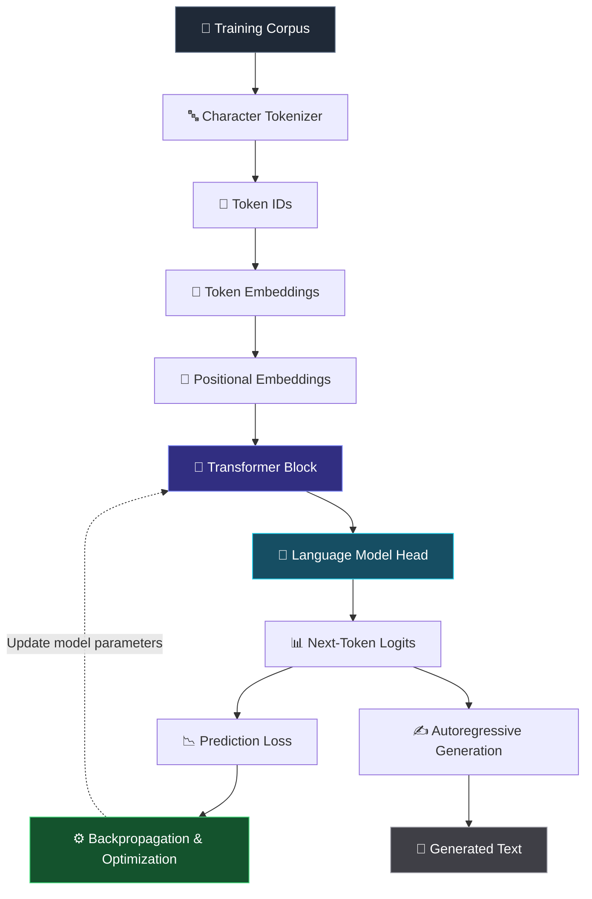
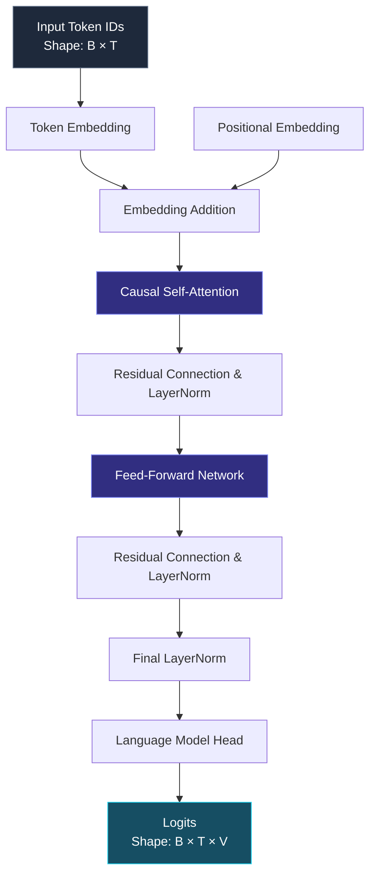
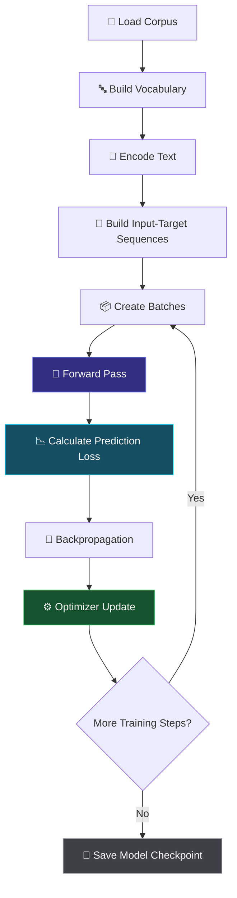
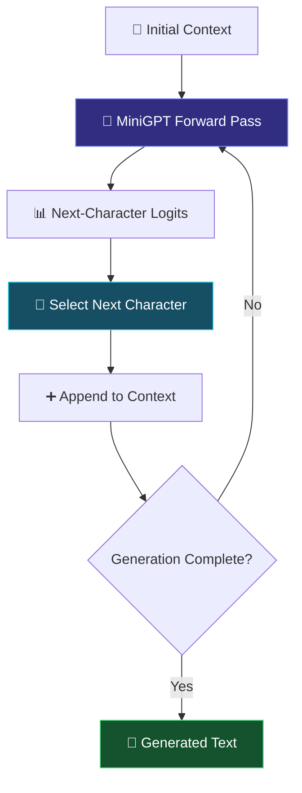

<div align="center">

# 🧠 MiniGPT

### Building a GPT-Style Language Model from Scratch

**Understand the architecture. Implement the mathematics. Train the model. Generate text.**

A hands-on exploration of decoder-only Transformers, causal self-attention, embeddings, and autoregressive language modeling using PyTorch.

<br>


<br>

**🔬 From individual characters to autoregressive text generation.**

[Overview](#-overview) · [Architecture](#-model-architecture) · [Installation](#-getting-started) · [Training](#-training) · [Evaluation](#-evaluation) · [Roadmap](#-roadmap)

</div>

---

## 📌 Overview

**MiniGPT** is a compact, educational implementation of a GPT-style language model built with Python and PyTorch.

The project explores the fundamental mechanisms behind autoregressive language models by implementing their essential components, from character-level tokenization to Transformer-based next-token prediction.

Rather than relying on a pretrained language model, MiniGPT learns patterns directly from a small text corpus.

The objective is simple:

> Understand how a Transformer represents sequences, learns contextual relationships, and generates text one token at a time.

### 🎯 Project Objectives

- 🧩 Implement a character-level tokenizer and vocabulary.
- 🔢 Explore tensors, embeddings, and sequential training data.
- 🧠 Understand causal self-attention and contextual representations.
- ⚙️ Build a compact decoder-only Transformer.
- 📉 Train the model using next-token prediction.
- ✍️ Generate text through autoregressive sampling.
- 📊 Investigate training loss, validation loss, and overfitting.

### ✨ Project Highlights

| Capability | Implementation |
|---|---|
| Tokenization | Character-level vocabulary |
| Language modeling | Autoregressive next-character prediction |
| Sequence representation | Learned token and positional embeddings |
| Attention mechanism | Causal self-attention |
| Neural architecture | Decoder-only Transformer |
| Optimization | Gradient-based training with PyTorch |
| Text generation | Iterative next-character sampling |
| Evaluation | Training and validation loss experiments |
| Hardware | CPU-compatible configuration |

---

## 🔄 How MiniGPT Works

MiniGPT follows the general workflow of a decoder-only language model.



### 🧩 The Pipeline Explained

| Stage | What happens? |
|---|---|
| 📄 Data | The training text is loaded from the corpus. |
| 🔤 Tokenization | Characters are mapped to integer IDs. |
| 🧩 Embedding | Token IDs are transformed into learned vectors. |
| 📍 Position | Positional embeddings encode sequence positions. |
| 🧠 Transformer | Attention and feed-forward processing build contextual representations. |
| 🎯 Prediction | The model produces logits for the next character. |
| 📉 Optimization | Training loss is used to calculate gradients and update parameters. |
| ✍️ Generation | The model repeatedly predicts and samples the next character. |

---

## 🏗️ Model Architecture

MiniGPT implements a compact, decoder-only Transformer inspired by the architecture used in GPT-style language models.

### Architecture at a Glance



**Notation**

- `B` — Batch size
- `T` — Sequence length
- `V` — Vocabulary size

The output logits represent the model's unnormalized scores for possible next characters at each sequence position.

### ⚙️ Current Model Configuration

| Parameter | Value |
|---|---:|
| Architecture | Decoder-only Transformer |
| Tokenization | Character-level |
| Embedding dimension | 32 |
| Context length | 32 characters |
| Transformer blocks | 1 |
| Trainable parameters | Approximately 15,417 |
| Training objective | Next-character prediction |
| Framework | PyTorch |
| Hardware target | CPU |

These settings describe a small model intended for learning and experimentation rather than production-scale text generation.

### 🧠 Core Components

**1. Character-Level Tokenization**

Converts text into numerical sequences using a vocabulary of individual characters.

**2. Token and Positional Embeddings**

Maps character IDs into learned vectors and incorporates information about each character's position in the sequence.

**3. Causal Self-Attention**

Allows each sequence position to use information from permitted preceding positions without accessing future tokens.

**4. Feed-Forward Network**

Processes the contextual representations produced by attention.

**5. Residual Connections and Layer Normalization**

Support information flow and normalize intermediate representations within the Transformer block.

**6. Language Model Head**

Maps hidden representations to vocabulary-sized logits for next-character prediction.

---

## 📂 Repository Structure

```text
minigpt-lab/
│
├── 📁 data/
│   └── input.txt
│
├── 🧠 minigpt.py
├── 🏗️ transformer_block.py
├── 🔤 tokenizer.py
├── 📊 dataset.py
│
├── ⚙️ train_minigpt.py
├── ⚙️ train_corpus.py
├── ✍️ generate.py
├── 📉 evaluate_minigpt.py
│
├── 🧩 embeddings.py
├── 🧩 attention_basics.py
├── 🧩 causal_attention.py
├── 🧩 learned_attention.py
│
├── 📚 context_model.py
├── 📚 first_model.py
├── 📚 sequence_data.py
├── 📚 tensor_basics.py
├── 📚 training_data.py
│
├── 💾 minigpt_model.pth
├── 📄 .gitignore
└── 📄 README.md
```

### 🔍 Important Modules

| File | Purpose |
|---|---|
| `tokenizer.py` | Character vocabulary and token conversion |
| `tensor_basics.py` | Introductory tensor experiments |
| `training_data.py` | Foundational training-data preparation |
| `sequence_data.py` | Sequence-based data preparation |
| `first_model.py` | Introductory model implementation |
| `context_model.py` | Context-dependent prediction experiments |
| `dataset.py` | Prepares training examples |
| `attention_basics.py` | Introduces attention concepts |
| `causal_attention.py` | Explores causal attention |
| `learned_attention.py` | Experiments with learned attention representations |
| `embeddings.py` | Embedding-related implementation |
| `transformer_block.py` | Transformer block implementation |
| `minigpt.py` | Main MiniGPT model |
| `train_minigpt.py` | Main model-training workflow |
| `train_corpus.py` | Corpus-oriented training and validation experiments |
| `generate.py` | Autoregressive text generation |
| `evaluate_minigpt.py` | Model evaluation |
| `data/input.txt` | Experimental training corpus |
| `minigpt_model.pth` | Saved PyTorch model checkpoint |

---

## 🛠️ Technology Stack

<div align="center">

| Technology | Role |
|---|---|
| 🐍 Python | Core implementation |
| 🔥 PyTorch | Neural networks, automatic differentiation, and optimization |
| 🔢 NumPy | Numerical computing where required |
| 🌿 Git | Version control |
| 🐙 GitHub | Source-code hosting and collaboration |

</div>

The current architecture is small enough to experiment with on a CPU. A dedicated GPU is not required.

---

## 🚀 Getting Started

Follow these steps to set up MiniGPT locally.

### Prerequisites

- Python 3.10 or a compatible Python version
- Git
- Basic Python knowledge
- An internet connection for initial dependency installation

### 1️⃣ Clone the Repository

```bash
git clone https://github.com/DropPlan-at13/minigpt-lab.git
cd minigpt-lab
```

### 2️⃣ Create a Virtual Environment

```bash
python3 -m venv .venv
source .venv/bin/activate
```

### 3️⃣ Install Dependencies

Upgrade pip:

```bash
python -m pip install --upgrade pip
```

Install PyTorch by selecting the appropriate configuration for your operating system and hardware.

**Official installation guide:**  
https://pytorch.org/get-started/locally/

Install NumPy if your selected scripts require it:

```bash
python -m pip install numpy
```

> 💡 **Note:** A pinned `requirements.txt` has not yet been included. Verify the imports and dependency versions used by the scripts before treating this setup as a fully reproducible environment.

### 4️⃣ Verify the Installation

Check the installed PyTorch version:

```bash
python -c "import torch; print(torch.__version__)"
```

Check CUDA availability:

```bash
python -c "import torch; print(torch.cuda.is_available())"
```

A `False` result is fine for CPU-based experiments.

---

## ⚙️ Training

MiniGPT supports experimental training workflows through its training scripts.

### Train the Main Model

```bash
python train_minigpt.py
```

### Run the Corpus Training Workflow

```bash
python train_corpus.py
```

These scripts implement separate workflows. Review their configuration, dataset preparation, and checkpoint-saving behavior before choosing one for an experiment.

### 🔬 Training Workflow



### What the Model Learns

During training, the model learns to predict the next character from the preceding context.

For example, given a sequence such as:

```text
Input:   The roboti
Target:  he robotic
```

Each input position is trained against its corresponding next-character target. The exact input-target construction depends on the sequence-preparation implementation.

The model parameters are updated to reduce the prediction loss.

---

## ✍️ Text Generation

Once a compatible checkpoint has been trained, run:

```bash
python generate.py
```

The generation script uses the model configuration and checkpoint-loading logic defined in the project.

### 🔄 Autoregressive Generation



At every step, MiniGPT predicts a distribution over the character vocabulary and selects a character according to its sampling strategy.

That character becomes part of the context for the next prediction.

This process repeats until the configured generation length is reached.

> 💡 Because the training corpus is very small, generated text may repeat training phrases or produce incoherent sequences. This is an expected limitation of the current model.

---

## 📊 Evaluation

Run the evaluation script:

```bash
python evaluate_minigpt.py
```

Inspect the implementation to confirm how the checkpoint, evaluation data, and loss calculations are configured.

### 📉 Understanding the Training Results

During one experiment, the corpus was divided chronologically into training and validation portions.

The observed losses were:

| Epoch | Training Loss | Validation Loss |
|---:|---:|---:|
| 25 | 1.4067 | 3.1318 |
| 50 | 0.5407 | 4.1724 |
| 100 | 0.1283 | 5.8692 |
| 200 | 0.0938 | 7.0081 |
| 300 | 0.0904 | 7.1264 |

*Results from one experimental run; exact results may vary across configurations and executions.*

### 🔍 What Do These Results Tell Us?

- 📉 **Training loss decreases:** The model becomes increasingly effective at predicting characters from the training corpus.
- 📈 **Validation loss increases:** Performance on the held-out text becomes worse as training continues.
- ⚠️ **Overfitting is evident:** The model fits its training examples without generalizing well to unseen text.

This experiment demonstrates an important machine learning principle:

> A decreasing training loss does not necessarily mean a model is learning patterns that generalize to new data.

The tiny corpus and limited validation set also mean that these results should not be interpreted as a reliable benchmark of general language-model quality.

---

## ⚠️ Current Limitations

MiniGPT is an educational prototype, not a production-ready language model.

| Limitation | Explanation |
|---|---|
| 📄 Small corpus | Approximately 305 characters in the initial
